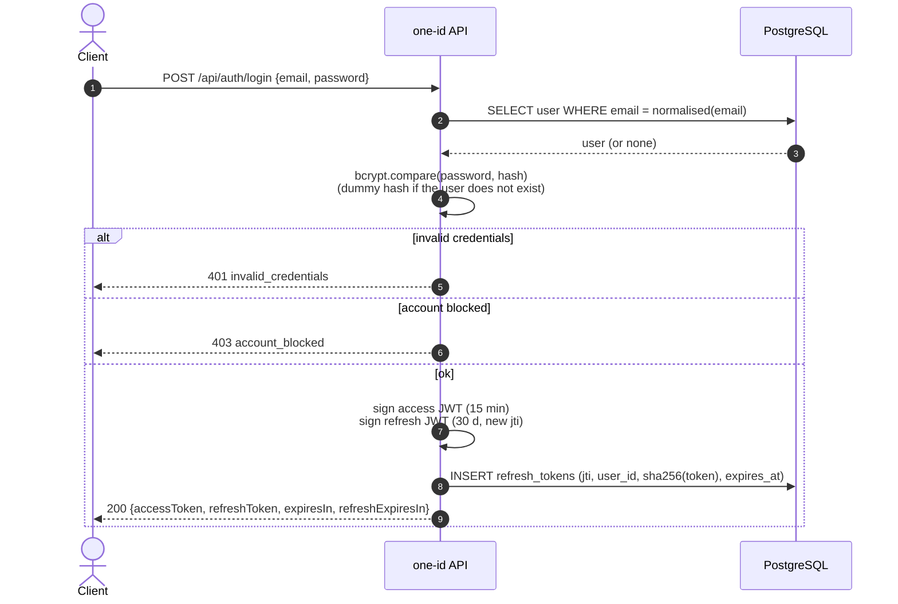
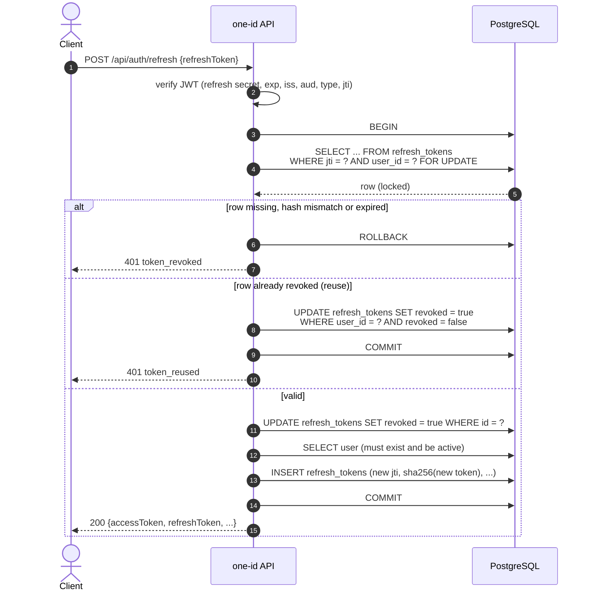

# one-id

[](https://github.com/guvanch999/one-id/actions/workflows/ci.yml)
[](LICENSE)

An identity and authentication service built with NestJS and PostgreSQL. It is
the foundation of a unified identification and authentication system: user
registration, password login, short-lived access tokens and rotating,
revocable refresh tokens.

> **Status: work in progress.** The authentication core described below is
> implemented and covered by tests. Everything under [Roadmap](#roadmap) is
> planned, not built.

## Contents

- [Features](#features)
- [Tech stack](#tech-stack)
- [Token model](#token-model)
- [API](#api)
- [Getting started](#getting-started)
- [Configuration](#configuration)
- [Database migrations](#database-migrations)
- [Tests](#tests)
- [Project structure](#project-structure)
- [Roadmap](#roadmap)
- [License](#license)

## Features

- Registration and login with e-mail and password (bcrypt, cost 12).
  E-mail addresses are normalised (trimmed, lower-cased) before they are stored
  or looked up.
- JWT access tokens (15 min) and refresh tokens (30 days), signed with
  **separate secrets** and checked for issuer, audience and token type.
- **Refresh token rotation**: every refresh revokes the presented token and
  issues a new pair inside one database transaction, with the token row locked
  (`SELECT ... FOR UPDATE`).
- **Reuse detection**: presenting a refresh token that was already rotated or
  revoked revokes every active session of that user.
- Logout of the current session or of all sessions.
- Blocked accounts cannot log in or refresh.
- Consistent JSON error format with machine-readable error codes and a request
  id; request logging with winston; `helmet` security headers; strict request
  validation (`class-validator`, unknown properties stripped).
- OpenAPI / Swagger UI outside production.

## Tech stack

| Area          | Choice                                         |
| ------------- | ---------------------------------------------- |
| Runtime       | Node.js 24, TypeScript                         |
| Framework     | NestJS 11                                      |
| Database      | PostgreSQL, Sequelize (`sequelize-typescript`) |
| Migrations    | `sequelize-cli`                                |
| Auth          | `@nestjs/jwt`, Passport JWT strategy, bcrypt   |
| Validation    | `class-validator`, `class-transformer`         |
| Observability | winston (JSON logs), request id per request    |
| API docs      | `@nestjs/swagger`                              |
| Tooling       | Jest, ESLint, Prettier, Docker, GitHub Actions |

## Token model

| Token   | Default lifetime | Signed with          | Claims                                              | Stored server-side     |
| ------- | ---------------- | -------------------- | --------------------------------------------------- | ---------------------- |
| Access  | 15 minutes       | `JWT_ACCESS_SECRET`  | `sub`, `email`, `type=access`, `iss`, `aud`         | No (stateless)         |
| Refresh | 30 days          | `JWT_REFRESH_SECRET` | `sub`, `email`, `type=refresh`, `jti`, `iss`, `aud` | Yes, one row per token |

Every refresh token has a row in `refresh_tokens`:

| Column       | Purpose                                                  |
| ------------ | -------------------------------------------------------- |
| `jti`        | Token id (UUID), also embedded in the JWT                |
| `user_id`    | Owner                                                    |
| `token_hash` | SHA-256 of the full token; the raw token is never stored |
| `expires_at` | Same instant as the JWT `exp`                            |
| `revoked`    | Set on rotation, logout or reuse detection               |

A refresh request is accepted only if the JWT verifies (signature, expiry,
issuer, audience, `type=refresh`) **and** its row exists, matches the hash, is
not revoked and has not expired.

**Rotation.** The row is read with `SELECT ... FOR UPDATE` in a transaction,
marked revoked, and the new pair is written in the same transaction. Two
concurrent requests with the same token are serialised by the row lock: only
the first one can rotate it.

**Reuse detection.** If the row exists but is already revoked, the token has
been used before, either by an attacker or by the legitimate client. The
service cannot tell which, so it revokes **all** active refresh tokens of the
user and answers `401 token_reused`. The revocation is committed before the
error is returned. Clients must therefore never send the same refresh token
twice (for example, from two browser tabs at once).

**Revocation.** `POST /api/auth/logout` revokes one refresh token (if given) or
all of them. Access tokens are stateless and stay valid until they expire (at
most 15 minutes by default).

### Login



### Refresh rotation and reuse detection



## API

All routes are prefixed with `/api`. Swagger UI is served at `/docs` when
`NODE_ENV` is not `production`.

| Method | Path                 | Auth          | Body                                                       | Success               |
| ------ | -------------------- | ------------- | ---------------------------------------------------------- | --------------------- |
| POST   | `/api/auth/register` | –             | `email`, `password` (8–128 chars), `firstName?`, `lastName?` | `201` token pair      |
| POST   | `/api/auth/login`    | –             | `email`, `password`                                        | `200` token pair      |
| POST   | `/api/auth/refresh`  | –             | `refreshToken`                                             | `200` token pair      |
| POST   | `/api/auth/logout`   | Bearer access | `refreshToken?` (omit to revoke all sessions)              | `204`                 |
| GET    | `/api/health`        | –             | –                                                          | `200 {"status":"ok"}` |

Token pair:

```json
{
  "accessToken": "eyJhbGciOi...",
  "refreshToken": "eyJhbGciOi...",
  "expiresIn": 900,
  "refreshExpiresIn": 2592000,
  "tokenType": "Bearer"
}
```

Errors share one shape:

```json
{
  "error": "token_revoked",
  "message": "Refresh token revoked or expired",
  "details": {},
  "timestamp": "2026-01-01T12:00:00.000Z",
  "path": "/api/auth/refresh",
  "requestId": "4b1c6a0e-..."
}
```

| `error`               | Status | Meaning                                              |
| --------------------- | ------ | ---------------------------------------------------- |
| `validation_error`    | 400    | Request body failed validation (`details.errors`)    |
| `invalid_credentials` | 401    | Unknown e-mail or wrong password (indistinguishable) |
| `token_expired`       | 401    | Refresh JWT invalid, expired or wrongly signed       |
| `token_revoked`       | 401    | Refresh token unknown, revoked or expired in the DB  |
| `token_reused`        | 401    | Rotated token presented again; all sessions revoked  |
| `unauthorized`        | 401    | Missing or invalid access token, wrong token type    |
| `account_blocked`     | 403    | User status is `blocked`                             |
| `conflict`            | 409    | E-mail already registered                            |

`requestId` echoes the `X-Request-Id` header or a generated UUID (it is absent
when a request is rejected by the auth guard before the logging interceptor
runs).

## Getting started

Requirements: Node.js 20+ (CI and the Docker image use 24) and Docker or a local
PostgreSQL.

### Run locally

```bash
npm ci
cp .env.example .env               # adjust if needed

docker compose up -d db            # or point DB_* at your own PostgreSQL
npm run db:migrate

npm run start:dev                  # http://localhost:3000/api, docs at /docs
```

### Run everything in Docker

```bash
docker compose up --build
```

This starts PostgreSQL, runs the migrations in a one-off container and starts
the API on port 3000. The compose file defaults to `NODE_ENV=production`
(Swagger UI off) and placeholder JWT secrets; override them with environment
variables:

```bash
JWT_ACCESS_SECRET=... JWT_REFRESH_SECRET=... docker compose up --build
NODE_ENV=development docker compose up --build   # with Swagger UI
```

The image is a multi-stage build on `node:24-alpine` that contains only
production dependencies and runs as the unprivileged `node` user.

### Try it

```bash
curl -s localhost:3000/api/auth/register \
  -H 'Content-Type: application/json' \
  -d '{"email":"alice@example.com","password":"StrongPassw0rd!"}'

curl -s localhost:3000/api/auth/refresh \
  -H 'Content-Type: application/json' \
  -d '{"refreshToken":"<refreshToken from the previous response>"}'
```

## Configuration

All configuration comes from environment variables; a `.env` file in the
project root is loaded automatically. See [`.env.example`](.env.example).

| Variable                     | Default          | Description                                                |
| ---------------------------- | ---------------- | ---------------------------------------------------------- |
| `NODE_ENV`                   | –                | `production` disables Swagger and requires the JWT secrets |
| `PORT`                       | `3000`           | HTTP port                                                  |
| `LOG_LEVEL`                  | `info`           | winston log level                                          |
| `DB_HOST`                    | `localhost`      | PostgreSQL host                                            |
| `DB_PORT`                    | `5432`           | PostgreSQL port                                            |
| `DB_USER`                    | `oneid`          | PostgreSQL user                                            |
| `DB_PASSWORD`                | `oneid`          | PostgreSQL password                                        |
| `DB_NAME`                    | `oneid`          | Database name                                              |
| `DB_LOGGING`                 | `false`          | Log SQL statements at debug level                          |
| `DB_SSL`                     | `false`          | Connect over TLS                                           |
| `DB_SSL_REJECT_UNAUTHORIZED` | `true`           | Verify the server certificate when `DB_SSL=true`           |
| `JWT_ACCESS_SECRET`          | dev fallback     | Access token secret (**required in production**)           |
| `JWT_REFRESH_SECRET`         | dev fallback     | Refresh token secret (**required in production**)          |
| `JWT_ACCESS_TTL`             | `15m`            | Access token lifetime (`900`, `15m`, `1h`, ...)            |
| `JWT_REFRESH_TTL`            | `30d`            | Refresh token lifetime                                     |
| `JWT_ISSUER`                 | `one-id`         | `iss` claim                                                |
| `JWT_AUDIENCE`               | `one-id-clients` | `aud` claim                                                |

Use two different, long random values for the JWT secrets:

```bash
node -e "console.log(require('crypto').randomBytes(48).toString('base64url'))"
```

## Database migrations

The schema is managed with `sequelize-cli` migrations in
[`database/migrations`](database/migrations); the application never calls
`sync()`. The CLI reads the same `DB_*` variables
([`database/config/config.js`](database/config/config.js)).

```bash
npm run db:migrate         # apply pending migrations
npm run db:migrate:undo    # roll back the last migration
```

## Tests

```bash
npm test                   # unit tests, no database or network needed
npm run test:cov           # with coverage
npm run lint:check         # ESLint + Prettier, no auto-fix
```

The unit tests run `AuthService` against an in-memory stand-in for the
`RefreshToken` model and a transaction mock that rolls back on errors, with a
real `JwtService` and real bcrypt. They cover registration (duplicate e-mail,
unique-index race), login (wrong password, unknown e-mail, blocked account),
refresh rotation (row locking, revoke and reissue, reuse detection that revokes
all sessions and stays committed, expired/forged/unknown tokens, rollback for
blocked users) and logout (one session, all sessions, foreign and already
revoked tokens), plus the JWT strategy, configuration parsing, e-mail
normalisation and the error filter.

End-to-end tests boot the whole application against a real database and are
**opt-in**:

```bash
docker compose up -d db
npm run db:migrate
npm run test:e2e
```

CI ([`.github/workflows/ci.yml`](.github/workflows/ci.yml)) runs lint, build
and unit tests, then the e2e suite against a PostgreSQL service container.

## Project structure

```text
.
├── database/
│   ├── config/config.js      # sequelize-cli connection config (env based)
│   └── migrations/           # users, refresh_tokens
├── src/
│   ├── main.ts               # bootstrap: helmet, /api prefix, validation, Swagger
│   ├── app.module.ts         # config and Sequelize wiring
│   ├── common/
│   │   ├── constants/        # error codes
│   │   ├── enums/            # user status
│   │   ├── filters/          # JSON error filter
│   │   ├── guards/           # JWT auth guard
│   │   ├── interceptors/     # request id and request logging
│   │   └── types/            # request context types
│   ├── config/               # database and JWT config
│   ├── database/models/      # User, RefreshToken
│   ├── health/               # GET /api/health
│   ├── logger/               # winston-backed Nest logger
│   ├── modules/
│   │   ├── auth/             # controller, service, DTOs, JWT strategy
│   │   └── users/            # user lookup and creation
│   └── swagger/              # OpenAPI setup
├── test/                     # opt-in e2e tests
├── Dockerfile
└── docker-compose.yml
```

## Roadmap

None of the following is implemented yet.

- **OAuth 2.0 / OpenID Connect provider**: authorization code flow with PKCE,
  client registration, discovery document, ID tokens.
- **Asymmetric signing** (RS256/EdDSA) with key rotation and a JWKS endpoint,
  so other services can verify tokens without sharing a secret.
- **Multi-factor authentication** (TOTP, recovery codes).
- **Roles and permissions** (RBAC) carried in tokens and enforced by guards.
- E-mail verification and password reset.
- Rate limiting and lockout for login attempts.
- Token families, so reuse detection revokes one login chain instead of every
  session of the user.
- Scheduled clean-up of expired refresh token rows; a health check that
  includes the database.
- Audit log of authentication events.

## License

[MIT](LICENSE) © Guvanch D.
